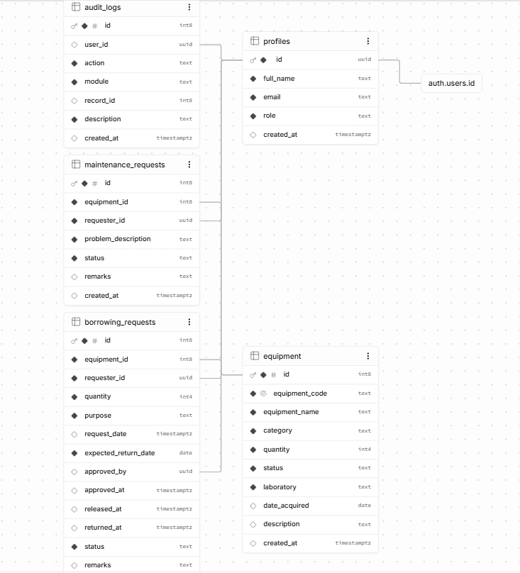
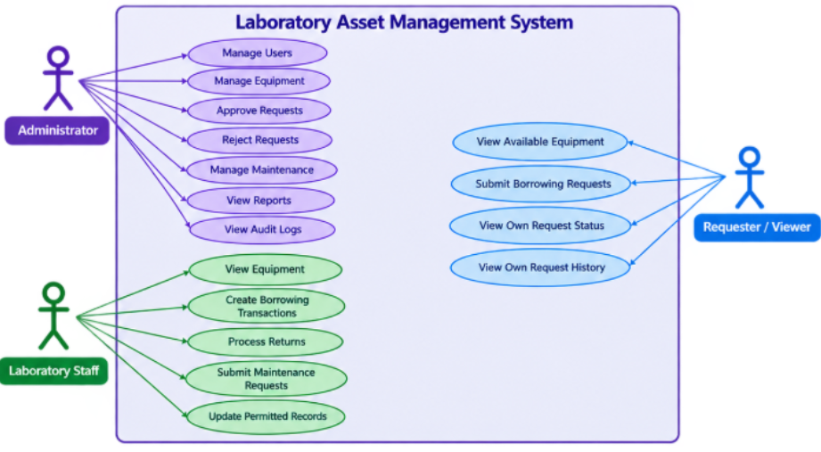

# Role-Based Laboratory Asset Management System

## Laboratory 4 - Role-Based Asset Transaction and Approval Management

A web-based system developed for the Systems Analysis and Design course to manage laboratory equipment, borrowing requests, approvals, returns, maintenance, users, and audit logs.

The system uses role-based access control to ensure that users can only perform functions allowed for their assigned roles.

---

## 1. System Objectives

The system aims to:

- Manage laboratory equipment and equipment status.
- Allow users to submit borrowing requests.
- Allow Administrators to approve or reject requests.
- Control access based on user roles.
- Enforce borrowing and return business rules.
- Record important transactions through audit logs.
- Improve the security, accountability, and traceability of laboratory assets.

---

## 2. User Roles

### Administrator

- Manage users
- Manage equipment
- View borrowing requests
- Approve or reject requests
- Manage maintenance
- View reports
- View audit logs

### Laboratory Staff

- View equipment
- Create borrowing transactions
- Process returns
- Submit maintenance requests
- Update permitted records

### Requester / Viewer

- View available equipment
- Submit borrowing requests
- View own request status
- View own request history

---

## 3. System Modules

| Module | Main Function |
|---|---|
| Login | User authentication |
| Dashboard | View system summary |
| Equipment | Manage and view laboratory equipment |
| Borrowing Requests | Submit and view borrowing requests |
| Approval | Approve or reject borrowing requests |
| Returns | Process returned equipment |
| Maintenance | Manage maintenance requests |
| Users | Manage user profiles |
| Reports | View transaction information |
| Audit Logs | Track important system actions |

---

## 4. Role-Permission Matrix

| Function | Administrator | Laboratory Staff | Requester / Viewer |
|---|:---:|:---:|:---:|
| Login | ✓ | ✓ | ✓ |
| View Dashboard | ✓ | ✓ | ✓ |
| View Equipment | ✓ | ✓ | ✓ |
| Manage Equipment | ✓ | ✓ | — |
| Submit Borrowing Request | ✓ | ✓ | ✓ |
| View Borrowing Requests | ✓ | ✓ | Own Only |
| Approve Request | ✓ | — | — |
| Reject Request | ✓ | — | — |
| Release Equipment | ✓ | ✓ | — |
| Process Return | ✓ | ✓ | — |
| Submit Maintenance Request | ✓ | ✓ | — |
| Manage Maintenance | ✓ | ✓ | — |
| Manage Users | ✓ | — | — |
| View Reports | ✓ | — | — |
| View Audit Logs | ✓ | — | — |
| Logout | ✓ | ✓ | ✓ |

**Legend:** ✓ = Allowed, — = Not Allowed

---

## 5. Borrowing Workflow

```text
Borrowing Request Submitted
            ↓
         Pending
            ↓
 Administrator Reviews
       ↙           ↘
  Approved        Rejected
      ↓
   Released
      ↓
   Returned
      ↓
    Closed

    ## 7. Entity Relationship Diagram (ERD)

The ERD shows the database entities and their relationships used in the system.



### Main Entities

- **PROFILES** – stores user information and roles.
- **EQUIPMENT** – stores laboratory equipment information.
- **BORROWING_REQUESTS** – stores borrowing transactions and approval details.
- **MAINTENANCE_REQUESTS** – stores equipment maintenance requests.
- **AUDIT_LOGS** – records important system activities.

### Main Relationships

- One Profile can create many Borrowing Requests.
- One Equipment can have many Borrowing Requests.
- One Profile can create many Maintenance Requests.
- One Equipment can have many Maintenance Requests.
- One Profile can have many Audit Logs.

---

## 8. Use Case Diagram

The Use Case Diagram shows the interaction between the three user roles and the system.



### Actors

**Administrator**
- Manage Users
- Manage Equipment
- Approve Requests
- Reject Requests
- Manage Maintenance
- View Reports
- View Audit Logs

**Laboratory Staff**
- View Equipment
- Create Borrowing Transactions
- Process Returns
- Submit Maintenance Requests
- Update Permitted Records

**Requester / Viewer**
- View Available Equipment
- Submit Borrowing Requests
- View Own Request Status
- View Own Request History